# NASA PSI Mikrogravite Yanma Verisi — Keşifsel Veri Analizi (EDA) Raporu

NASA Space Apps 2026 · *Flame in Freefall* · Bu raporda **hiçbir model eğitilmemiştir**; yalnızca betimsel istatistik, ilişki ölçüleri ve fiziksel tutarlılık kontrolleri yer alır. Tüm sayılar `analysis/outputs/` altındaki script çıktılarından otomatik alınmıştır (`scripts/09_build_report.py`).

## 1. Yönetici özeti

1. **`smoke_dataset.csv` repoda yok.** Duman tablosu PSI-101 *Combined_SAMER_Results* çalışma kitabından yeniden kuruldu (flight: SAME + SAME-R, ground ayrı sayfa). Flight'ta `amd_um = 1000·M1/M0` birebir doğrulandı; ground sayfasındaki eşleme ise bu ilişkiyi sağlamıyor (medyan göreli fark ~%90) → ground **ayrı** raporlandı.
2. **En güçlü hedef adayları:** FLEX yanma süresi / yanma sabiti K / sönme çapı, CFI sıcak alev K'sı ve SAME duman partikül çapı (puan ≥4/5). ACME yanma süresi ve tutuşma da kullanılabilir ama **yalnızca PSI-159 (CFI-G)** satırlarında tanımlı: PSI-10 Flame Design tablolarında sonuç sütunu yok.
3. **d² yasası veride görülüyor:** FLEX'te tam yanan (Completion) damlacıklarda log t_b – log d0 eğimi **2.13** (%95 GA 1.76–2.52, beklenen 2). Sönmeyle bitenlerde eğim 1.00: bu testlerde süre erken kesildiği için yasa beklendiği gibi bozuluyor.
4. **Belirsiz birim çözüldü:** FLEX 'Burning rate; mm' sütunu, (d0²−d_ext²)/t_b ile karşılaştırıldığında oran medyanı **0.95** → sütun mm²/s cinsinden K.
5. **BASS-II stokiyometri kontrolü geçti:** PMMA için ölçülen ΔCO2/ΔO2 = **-0.80** (teorik −5/6 = −0.83). O2/CO2 sensör verisi fiziksel olarak tutarlı.
6. **Smoke'ta Simpson paradoksu:** Rt/R0 (ısıtıcı sıcaklığı) ile partikül çapı arasındaki ilişki tüm veride negatif (ρ≈−0.27), malzeme sabit tutulunca **pozitif** (kısmi ρ≈+0.49; 5 malzemenin 5'inde de pozitif). Malzeme feature'ı modelden çıkarılırsa yanlış yönde bir ilişki öğrenilir.
7. **ACME-inverse'te gün etkisi baskın:** yanma süresi ile ortam yakıt kesri / basınç arasındaki ilişkinin büyük kısmı test günü sabitlenince kayboluyor (ör. ρ −0.54 → −0.04). Bunun nedeni gün içinde yanma ürünlerinin birikmesi (vitiasyon).
8. **ACME-normal'de tutuşma sınırı belirgin:** ~%21 O2'de bütan/propan için sıcak tutuşma yok, %35–40 O2'de çoğunlukla kendiliğinden sönme (SE). Tutuşan alevlerde O2 arttıkça yanma süresi uzuyor (ρ=0.29–0.67): yüksek O2'de radyatif sönmeye karşı daha dayanıklı alev oluşuyor.
9. **Sızıntı riski yüksek:** her hedef için aynı anda ölçülen çıktı sütunları (ör. XO2 final, peak burner T, d_ext, M0/M1, rad*) `feature_catalog.csv` içinde `role=leakage` olarak işaretlendi. **Doğrulama mutlaka grup bazlı olmalı** (gün / PI / malzeme / kampanya).
10. **Model önerisi (eğitmeden):** küçük n (108–274) → Ridge/Lojistik baseline + sığ, düzenlileştirilmiş ağaçlar; kategorik yoğun tablolarda CatBoost; fiziksel yönü bilinen ilişkilerde (d0↑→t_b↑, O2↑→K↑) monotonluk kısıtı.

## 2. Veri envanteri ve kalite

- Kanonik dosya (`audit/canonical_files.csv`, use==True): **2487** (kopya ve 'wrong' dosyalar hariç). Kategori dağılımı: time_series 1319, calibration_engineering 995, test_summary 75, particle_level 41, other 35, experimental_table 22. Ayrıntı: `outputs/inventory_summary.md`.
- Analiz edilen tablolar: Tier 1 = acme_normal, acme_inverse, flex, bass2, smoke, cfi; Tier 2 = SAFFIRE I/II/III, SPICE, ACME test-günü tabloları (PSI-20/21/22/23); Tier 3 = SAFFIRE-III telemetri, SAME-R HKP.

### 2.1 Yükleme ve temizlik

| table         |   rows_before |   rows_after |   dropped | drop_reason                                                                            |   flagged_cells | flag_detail                                                                                                                                                                                                                                                                                                                                  |
|:--------------|--------------:|-------------:|----------:|:---------------------------------------------------------------------------------------|----------------:|:---------------------------------------------------------------------------------------------------------------------------------------------------------------------------------------------------------------------------------------------------------------------------------------------------------------------------------------------|
| acme_normal   |           386 |          386 |         0 | tamamen boş satırlar                                                                   |             410 | x_fuel:60; m_fuel_mg_s:60; m_n2_mg_s:60; m_tot_mg_s:60; zst:60; tad_k_calc:60; 159:tad_k_calc:2; 159:zst:2; 159:peak_burner_T_C:46                                                                                                                                                                                                           |
| acme_inverse  |          1135 |          274 |       861 | tamamen boş satırlar (PSI-159 inverse: 861 boş satır)                                  |              67 | xo2:11; m_o2_mg_s:8; m_n2_mg_s:11; m_tot_mg_s:11; zst:11; tad_k_calc:11; 159:peak_burner_T_C:2; 159:peak_burner_T_K:2                                                                                                                                                                                                                        |
| flex          |           274 |          274 |         0 | tamamen boş satırlar                                                                   |              36 | d0_mm:6; d_ext_mm:28; burn_time_approx(~):2                                                                                                                                                                                                                                                                                                  |
| bass2         |           129 |          129 |         0 | tamamen boş satırlar                                                                   |              43 | o2_final_pct:2; co2_init_pct:2; co2_final_pct:5; co_init_ppm:3; co_final_ppm:8; co_negative_rows:13; o2_final_anomaly_rows:5; co_overrange_cells:5                                                                                                                                                                                           |
| smoke         |           214 |          167 |        47 | malzemesiz 10 satır (ground sayfası alt notları) + DBP 37 satır (kalibrasyon aerosolü) |             143 | sample_temp_c:4; mass_loss_mg:3; zero->NaN:m0_per_cc:12; zero->NaN:m1_mm_per_cc:10; zero->NaN:m3_mpass:19; zero->NaN:dusttrak_a_mg_m3:29; zero->NaN:dusttrak_b_mg_m3:10; zero->NaN:amd_um:3; zero->NaN:dam_um:3; zero->NaN:mpass_3_2:21; zero->NaN:sigma_g:3; zero->NaN:dg_um:3; zero->NaN:inlet_velocity_cm_s:22; zero->NaN:sample_temp_c:1 |
| cfi           |           227 |          227 |         0 | -                                                                                      |               0 |                                                                                                                                                                                                                                                                                                                                              |
| saffire1      |             4 |            4 |         0 | -                                                                                      |               0 |                                                                                                                                                                                                                                                                                                                                              |
| saffire2      |            15 |           15 |         0 | -                                                                                      |               0 |                                                                                                                                                                                                                                                                                                                                              |
| saffire3      |             2 |            2 |         0 | -                                                                                      |               0 |                                                                                                                                                                                                                                                                                                                                              |
| spice         |           469 |          469 |         0 | -                                                                                      |               0 |                                                                                                                                                                                                                                                                                                                                              |
| acme_testdays |           100 |          100 |         0 | -                                                                                      |               0 |                                                                                                                                                                                                                                                                                                                                              |

Önemli temizlik kararları (tamamı `outputs/assumptions.md`):

- `RAMP / RAMPED / LOW O2 / #DIV/0! / #VALUE! / none / – / -` → NaN + `<sütun>_flag` (token metni saklı). **Hiçbir eksik değer 0 ile doldurulmadı.**
- PSI-159 inverse tablosundaki **861 boş satır** atıldı; geriye 154 test kaldı.
- BASS-II CO değerlerinde `OR / over / >500` sağdan sansürlü (ölçüm aralığı aşılmış) → NaN + `_overrange`. 13 testte negatif CO var; düzeltilmedi, işaretlendi.
- Smoke: 37 DBP satırı (kalibrasyon aerosolü) çıkarıldı. Çap/konsantrasyon = 0 değerleri ölçülmemiş anlamına geldiği için NaN yapıldı.
- Orijinal sütunlar korundu; XO2 için % sütunları **ek** olarak üretildi (`xo2_init_pct` vb.).

### 2.2 Varsayımlar (özet)

- **acme_color_limit**: PSI-159 inverse 'Color'='limit' bir renk değil (sıcaklık limitine ulaşıldı yorumu) -> flame_color NaN, color_hit_limit=True.
- **acme_ext_mode**: 'Self-ext or flow term' içindeki '-' = tutuşma olmadı/uygulanamaz -> ext_mode NaN; SE=self-extinction, FT=flow termination.
- **acme_flash**: PSI-159 inverse 'Hot ignition'='flash': anlık parlama, sürekli alev değil -> ignition_class='flash' (3 sınıf korunur), ikili hot_ignition=0.
- **acme_p_unit**: PSI-159 'approx p (bar)' -> p_atm = p_bar/1.01325 (yaklaşık basınç). PSI-10 'pmean (atm)' p_atm olarak kullanıldı.
- **acme_psi10_targets**: PSI-10 Flame Design tablolarında yanma süresi / tutuşma / söndürme sütunu YOK. Bu hedefler yalnızca PSI-159 (CFI-G) satırlarında tanımlı.
- **acme_ramp**: PSI-10 'RAMP/RAMPED/LOW O2' satırları akış rampası yapılan testler: sayısal değer NaN, token <col>_flag'de saklı, satır SİLİNMEDİ.
- **acme_tad**: 'Tad (K)' adyabatik alev sıcaklığı HESAPLANMIŞ bir büyüklük -> tad_k_calc adıyla tutuldu; ölçüm değil, girdilerin (XO2, yakıt, Zst) fonksiyonu.
- **acme_tfp**: TFP (Yes/No) anlamı belgelenmemiş; kategorik olarak tutuldu, birim/anlam atanmadı.
- **bass2_air_display**: Air/Fan display bir hız değil cihaz potansiyometre okuması; çoğu hücre test boyunca ayar dizisi ('5 3 2 ext'). air_display_initial = ilk sayı; birim unit_unknown.
- **bass2_co_censor**: BASS-II CO 'OR'/'over'/'>500' = ölçüm aralığı aşıldı (sağdan sansürlü) -> NaN + *_overrange=True. 'none' -> NaN.
- **bass2_material**: BASS-II 'Fuel Sample Material' serbest metin -> material (PMMA/SIBAL/Nomex/Wax candle), geometry (film/slab/rod/fabric/sphere_section/candle), thickness_mm (micron/mm/inç'ten). Çubuklarda 'thickness' = çap. '4 cm spherical section' PMMA VARSAYILDI. SIBAL'de '2 cm' genişliktir, kalınlık NaN.
- **bass2_negative_co**: Negatif CO değerleri DÜZELTİLMEDİ; co_negative_flag ile işaretlendi (sensör ofseti olası).
- **bass2_o2_anomaly**: o2_final_anomaly_flag: final O2 < %10 ya da O2'nin test boyunca >0.5 puan ARTMASI (fiziksel değil) -> işaretlendi, düzeltilmedi.
- **cfi_has_cool**: has_cool_flame = kcool ölçülmüş mü (1/0) - türetilmiş ikili hedef adayı; kcool analizi yapılmamış testlerde de 0 olabileceği için 'completed_analysis' ile birlikte yorumlanmalı.
- **cfi_hf_burn**: 'hf burn time' sütununun birimi belirtilmemiş; değer aralığına göre saniye VARSAYILDI (hf = hot flame).
- **cfi_merge**: PSI-39 cfi = Master_Sheet ⋈ DATA ⋈ Igniter (flex number, 1:1). Experimental_table (87) Master'ın alt kümesi; in_experimental_table ile işaretlendi.
- **flex_K_d2**: K_from_d2_law = (d0² - d_ext²)/t_b yalnızca bilgi amaçlı türetildi; hedef K ile sızıntı ilişkisi var (hedef olarak kullanılamaz).
- **flex_approx**: FLEX 'Burn time' içindeki '~6', '~9' -> 6, 9 sayısal + burn_time_approx=True. '–' -> NaN.
- **flex_burn_rate_unit**: PSI-69 'Burning rate; mm' başlığındaki birim eksik; değer aralığı (~0.4-1 ) damlacık yanma sabiti K ile uyumlu -> burn_rate_K_mm2_s (mm²/s) VARSAYILDI.
- **hkp_segments**: SAME-R HKP: yalnızca PSI-101 'Raw_Data_HKPData_gmt*' (44 dosya) kullanıldı (PSI-102 HKP'leri kopya/ortalama sayfaları içeriyor). elapsedtesttime geri düştüğünde yeni segment; ana zaman elapsedtesttime (positionerclock değil). ptrak -999/9999/negatif -> NaN.
- **saffire2_spread**: SAFFIRE-II spread rate 1-g ölçümüdür, mikrogravite değildir; hedef olarak kullanılmadı.
- **saffire3_time**: SAFFIRE-III 1 Hz export'larında zaman = 'relative time (ms)'/1000 (RelativeSeconds başlıklı sütunlar da aslında ms). Negatif zaman satırları ve tüm kanalların 0 olduğu sentinel satırlar atıldı. 3 telemetri export'u birleştirilmedi.
- **smoke_ground_map**: Ground eşlemesi DOĞRULANMADI: amd_um <- 'Best Diameter Ion B/Ptrak Count Mean Diameter', dam_um <- 'DTRak B Diameter of average mass', m0 <- 'Mo Best Diameter', m1 <- 'Ion B M1'. Analizlerde flight-only ve flight+ground AYRI raporlanır.
- **smoke_leak**: amd_um = M1/M0 olduğundan m0_per_cc, m1_mm_per_cc, log_m0 ve ionb_moment amd_um hedefi için SIZINTIDIR; dam_um, dg_um, sigma_g, dusttrak, mpass da aynı anda ölçülen çıktılardır.
- **smoke_source**: `smoke_dataset.csv` repoda YOK. Yerine PSI-101 'Combined_SAMER_Results_06_02_14' çalışma kitabından yeniden kuruldu: flight = 'Reduced_data_sheet' (SAME=1, SAME-R=2), ground = 'SAME_Ground_Test_Results'.
- **smoke_zero**: Duman tablosunda çap/konsantrasyon/hız = 0 değerleri fiziksel değil (ölçülmedi) -> NaN. Sayılar load_report'ta. BELİRSİZ: inlet_velocity_cm_s=0 olan 22 satırın tamamı SAME-R'da; düşük akışlı run'lar olduğu için gerçek 0 olma ihtimali var — feature olarak kullanmadan önce teyit edilmeli.
- **spice_duration**: SPICE flame_duration_s = GMT Flame Off - GMT ignition (gece yarısı geçişi +86400 s). Aynı satırın tekrarları dup_of_previous ile işaretlendi, SİLİNMEDİ (aynı ayarda tekrar alev olabilir).
- **ts_events**: SAFFIRE-III olay tespiti betimseldir: ateşleme = igniter current > 0.5 A ilk an; pik = 4 radyometre ortalamasının (5 nokta medyan) maksimumu; sönme = pikten sonra sinyalin (taban + %10·genlik) altına ilk düştüğü an. Taban = ilk 60 s medyanı.

### 2.3 Eksiklik

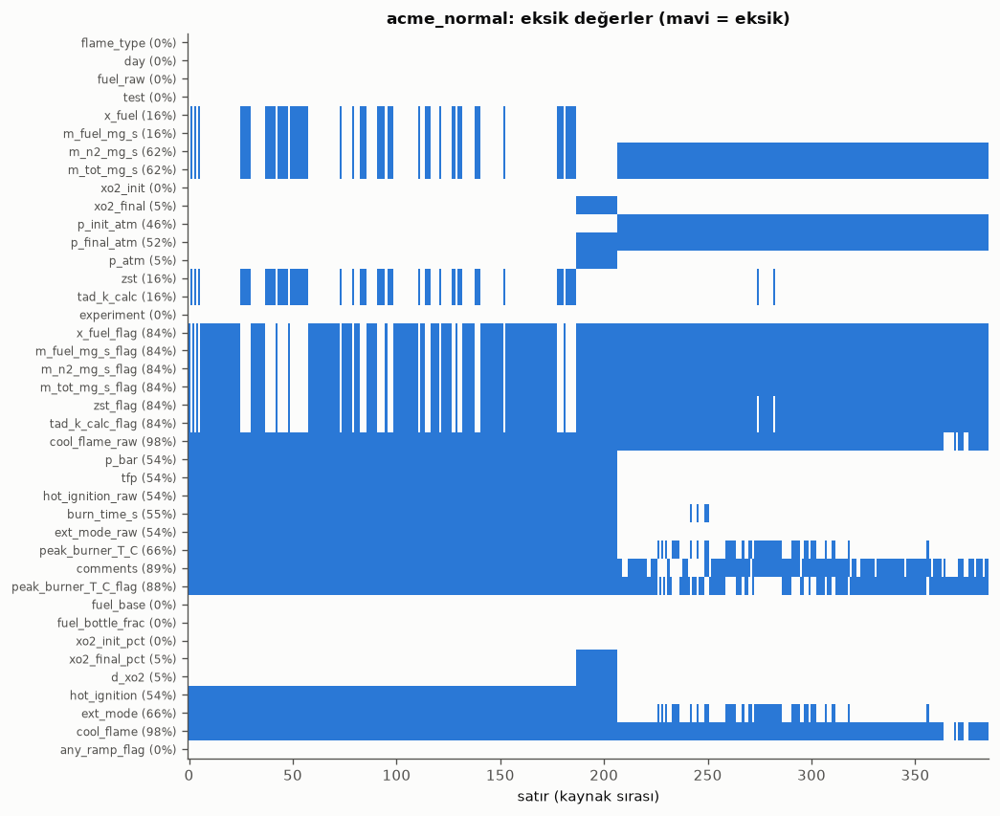

ACME-normal'deki eksiklik **yapısal**: PSI-10 ve PSI-159 farklı sütun setlerine sahip; sonuç sütunları (burn time, hot ignition, ext mode) yalnızca PSI-159'da var.

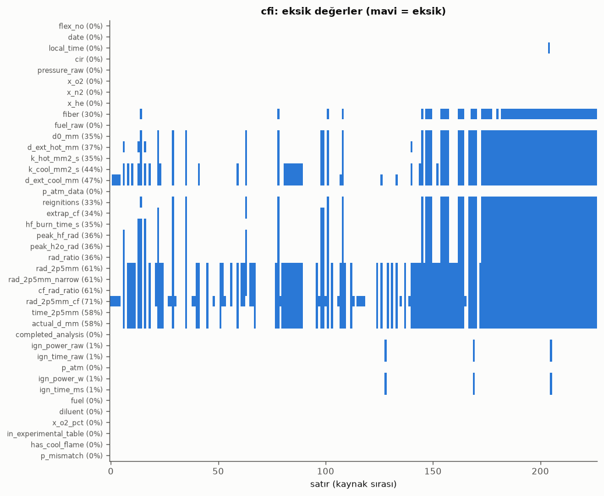

CFI'de Master sayfasındaki 227 testin 148'inde DATA (d0, K, burn time) analizi tamamlanmış.

## 3. Hedef adayları

Puan (1–5) kural tabanlı: n, en güçlü etki büyüklüğü, sınıf dengesi ve alan bilgisine dayalı düzeltme. Ayrıntı: `outputs/target_candidates.md`.

| dataset      | target            | task       |   n | class_balance                                |   max_effect |   score_1_5 | rationale                                                                              |
|:-------------|:------------------|:-----------|----:|:---------------------------------------------|-------------:|------------:|:---------------------------------------------------------------------------------------|
| flex         | burn_time_s       | regression | 268 | nan                                          |         0.44 |           5 | d² yasası doğrulandı (Completion eğimi≈2); test_end ile birlikte yorumlanmalı.         |
| flex         | burn_rate_K_mm2_s | regression | 258 | nan                                          |         0.59 |           5 | Birim varsayımı (mm²/s) d² tutarlılık kontrolüyle desteklendi (oran≈0.95).             |
| flex         | d_ext_mm          | regression | 197 | nan                                          |         0.67 |           5 | Yalnızca sönme/kesinti ile biten testlerde tanımlı (seçim yanlılığı).                  |
| cfi          | k_hot_mm2_s       | regression | 148 | nan                                          |         0.6  |           5 | Fiziksel olarak iyi tanımlı; O2/He/basınç ilişkileri güçlü.                            |
| flex         | test_end          | multiclass | 274 | Extinction:186, Disruption:61, Completion:27 |         0.58 |           4 | 3 sınıf, Completion azınlık (%10).                                                     |
| acme_normal  | hot_ignition      | binary     | 179 | 1.0:132, 0.0:47                              |         0.43 |           4 | Net fiziksel sınır (≈21% O2'de tutuşma yok); PSI-10'da yok.                            |
| smoke        | amd_um            | regression | 153 | nan                                          |         0.53 |           4 | M0/M1 sızıntı; ground eşlemesi doğrulanmadı; Simpson (Rt/R0 × material).               |
| cfi          | hf_burn_time_s    | regression | 147 | nan                                          |         0.52 |           4 | Birim saniye varsayımı; d0 ile negatif ilişki (radyatif sönme) — d² yasası uygulanmaz. |
| acme_normal  | burn_time_s       | regression | 132 | nan                                          |         0.58 |           4 | Yalnızca CFI-G; FT (akış kesildi) testlerinde süre sağdan sansürlü olabilir.           |
| smoke        | dusttrak_b_mg_m3  | regression | 148 | nan                                          |         0.78 |           3 | Seyreltme/kalibrasyon düzeltmeli cihaz okuması; material baskın.                       |
| cfi          | d_ext_hot_mm      | regression | 144 | nan                                          |         0.87 |           3 | d0 ile ρ=0.87 — büyük ölçüde başlangıç çapının ölçeği; d_ext/d0 daha anlamlı.          |
| acme_inverse | ext_mode          | binary     | 139 | SE:81, FT:58                                 |         0.56 |           3 | FT operasyonel karar olabilir; gün etkisi baskın.                                      |
| acme_inverse | burn_time_s       | regression | 131 | nan                                          |         0.67 |           3 | Gün içi vitiasyon (ortam yakıtı birikimi) güçlü karıştırıcı; FT sansürü.               |
| bass2        | d_o2_pct          | regression | 122 | nan                                          |         0.71 |           3 | PI (araştırmacı) etkisi baskın; tutuşma süresi/akış ayar dizisi bilinmiyor.            |
| bass2        | d_co2_pct         | regression | 121 | nan                                          |         0.72 |           3 | PI etkisi baskın; ΔO2 ile neredeyse stokiyometrik (aynı bilgi).                        |
| bass2        | co_final_ppm      | regression | 108 | nan                                          |         0.7  |           3 | Sansürlü (OR/>500) ve negatif değerler; küçük n.                                       |
| acme_inverse | hot_ignition      | binary     | 154 | 1.0:131, 0.0:23                              |         0.47 |           2 | Azınlık sınıfı ~%15; 'flash' 3. sınıf olarak ayrıca modellenebilir.                    |
| cfi          | has_cool_flame    | binary     | 146 | 1:124, 0:22                                  |         0.38 |           2 | Türetilmiş (kcool ölçülmüş mü); azınlık %15; analiz tamamlanma durumu karışabilir.     |
| acme_normal  | ext_mode          | binary     | 133 | SE:102, FT:31                                |         0.33 |           2 | FT operasyonel karar (akış kesildi) olabilir — fiziksel söndürme değil.                |

### Ekip hedefleriyle eşleşme

| Ekip hedefi | Veri karşılığı | Sonuç |
|---|---|---|
| Yanma süresi | flex.burn_time_s, cfi.hf_burn_time_s, acme_*.burn_time_s (CFI-G) | **Ana hedef**: FLEX en iyisi (n=268, d² doğrulandı) |
| Tutuşur mu / ne zaman | acme_normal.hot_ignition, acme_inverse.hot_ignition (+flash), flex.test_end | **Sınıflandırma**: ACME-normal net O2 sınırı gösteriyor |
| Yanma hızı (K) | flex.burn_rate_K_mm2_s, cfi.k_hot_mm2_s | Güçlü hedef (O2, seyreltici, basınç ile açıklanıyor) |
| Yayılma hızı | yok (BASS/BASS-II yalnızca video; SAFFIRE-II spread rate 1-g) | Kapsam dışı |
| Toksik gaz / duman | smoke.amd_um, smoke.dusttrak_b_mg_m3, bass2.co_final_ppm, bass2.d_co2_pct | İkincil hedef: amd_um en iyisi (flight-only) |
| Ortamdaki gaz | x_o2/x_n2/x_he/x_co2, p_atm | Feature; bass2.d_o2_pct hedef olarak da mümkün (PI etkisi baskın) |
| Yayılma yönü | SAFFIRE concurrent/opposed | Yalnızca 2–15 numune → betimsel |
| Radyometre | SAFFIRE-III 4 radyometre | Run başına feature çıkarımı (Bölüm 7) |

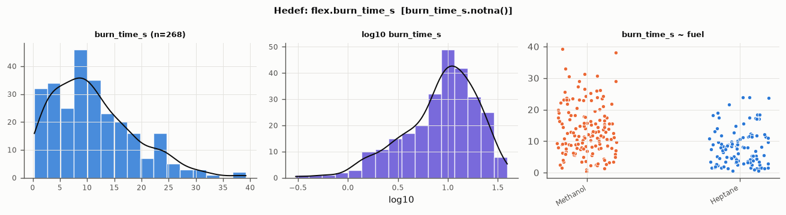

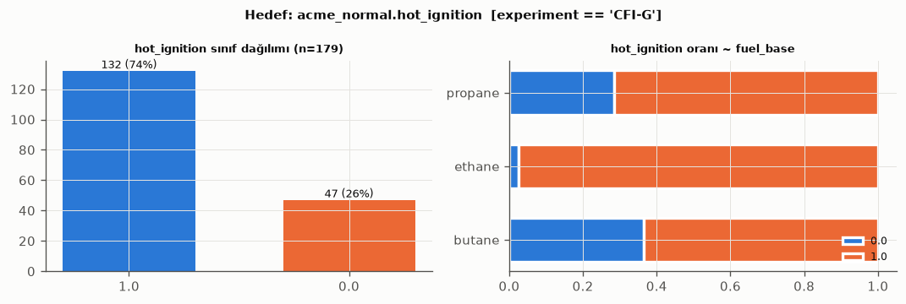

## 4. Dağılımlar

Tüm tablolar için histogram + KDE (çarpık ve pozitif sütunlarda log ölçek yan yana): `figures/dist_<tablo>.png`; kategori bazlı boxplot'lar: `figures/box_<tablo>.png`; kategorik frekanslar: `figures/cat_<tablo>.png`.

### Hedef dönüşüm önerileri (hedef alt kümesinde)

| table        | column                               |   n |   skew |   boxcox_lambda | suggest                                         |
|:-------------|:-------------------------------------|----:|-------:|----------------:|:------------------------------------------------|
| acme_normal  | burn_time_s [hedef alt kümesi]       | 132 |   1.87 |            0.19 | log / log1p (Box-Cox λ≈0)                       |
| acme_inverse | burn_time_s [hedef alt kümesi]       | 131 |   1.08 |            0.23 | log / log1p (Box-Cox λ≈0)                       |
| flex         | burn_time_s [hedef alt kümesi]       | 268 |   0.92 |            0.39 | sqrt (λ≈0.5)                                    |
| flex         | burn_rate_K_mm2_s [hedef alt kümesi] | 258 |   0.58 |            0.65 | dönüşüm gerekmez                                |
| flex         | d_ext_mm [hedef alt kümesi]          | 197 |   0.26 |          nan    | dönüşüm gerekmez                                |
| bass2        | d_o2_pct [hedef alt kümesi]          | 122 |  -1.66 |          nan    | Yeo-Johnson (λ=3.18) - sıfır/negatif değer var  |
| bass2        | d_co2_pct [hedef alt kümesi]         | 121 |   1.85 |          nan    | Yeo-Johnson (λ=-1.94) - sıfır/negatif değer var |
| bass2        | co_final_ppm [hedef alt kümesi]      | 108 |   1.34 |            0.2  | log / log1p (Box-Cox λ≈0)                       |
| smoke        | amd_um [hedef alt kümesi]            | 153 |   2.55 |            0.12 | log / log1p (Box-Cox λ≈0)                       |
| smoke        | dusttrak_b_mg_m3 [hedef alt kümesi]  | 148 |   1.5  |            0.21 | log / log1p (Box-Cox λ≈0)                       |
| cfi          | k_hot_mm2_s [hedef alt kümesi]       | 148 |   2.24 |            0.39 | sqrt (λ≈0.5)                                    |
| cfi          | hf_burn_time_s [hedef alt kümesi]    | 147 |   0.47 |            0.53 | dönüşüm gerekmez                                |
| cfi          | d_ext_hot_mm [hedef alt kümesi]      | 144 |   0.73 |           -0.98 | dönüşüm gerekmez                                |

- Yanma süreleri (ACME) ve partikül çapı / kütle konsantrasyonu sağa çarpık; **log** dönüşümü uygun (Box-Cox λ≈0.1–0.2).
- CFI K ve FLEX burn time için **karekök** (λ≈0.4).
- BASS-II ΔO2/ΔCO2 sıfır ve negatif değerler içeriyor → Yeo-Johnson veya dönüşümsüz robust kayıp.

### Sınıf dengesizliği

| table        | column                |   levels | majority   |   imbalance_ratio |   minority_pct |
|:-------------|:----------------------|---------:|:-----------|------------------:|---------------:|
| acme_normal  | tfp                   |        2 | No         |              8.94 |           10.1 |
| acme_normal  | fuel_base             |        4 | ethylene   |              4.56 |           10.6 |
| acme_normal  | ext_mode              |        2 | SE         |              3.29 |           23.3 |
| acme_normal  | cool_flame            |        2 | yes        |              7    |           12.5 |
| acme_inverse | tfp                   |        2 | No         |             11.8  |            7.8 |
| acme_inverse | ignition_class        |        3 | yes        |             16.4  |            5.2 |
| acme_inverse | flame_color           |        3 | blue       |              5.9  |           11   |
| acme_inverse | color_hit_limit       |        2 | False      |              3.97 |           20.1 |
| flex         | test_end              |        3 | Extinction |              6.89 |            9.9 |
| flex         | burn_time_approx      |        2 | False      |            136    |            0.7 |
| bass2        | pi                    |        6 | T'ien      |              7.25 |            3.1 |
| bass2        | co_init_ppm_overrange |        2 | False      |            128    |            0.8 |

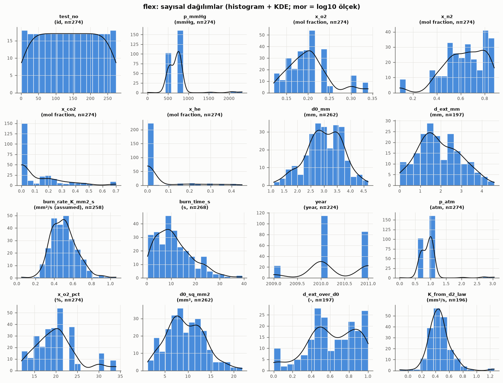

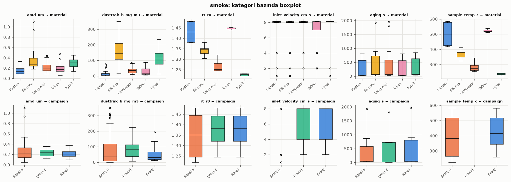

Smoke boxplot'unda `rt_r0` ve `sample_temp_c` neredeyse yalnızca malzemeye bağlı (her malzeme kendi ısıtıcı ayarında test edilmiş). Bu durum Bölüm 5'teki Simpson bulgusunun kaynağı.

## 5. İlişkiler ve korelasyon

Ölçüler: sayısal–sayısal Pearson + Spearman; kategorik–sayısal η ve Kruskal-Wallis ε²; kategorik–kategorik bias-düzeltilmiş Cramér's V; hedef–feature karşılıklı bilgi (MI). Tablo içinde BH-FDR düzeltmesi uygulandı. Ham sonuçlar: `outputs/assoc_<tablo>.csv`.

### Hedef başına en güçlü 5 feature

| table        | target            | task       |   n | top5                                                                                                                                                                                                    |
|:-------------|:------------------|:-----------|----:|:--------------------------------------------------------------------------------------------------------------------------------------------------------------------------------------------------------|
| acme_normal  | burn_time_s       | regression | 132 | tad_k_calc (spearman_rho=0.58, MI=0.72); xo2_init (spearman_rho=0.58, MI=0.63); p_atm (spearman_rho=-0.32, MI=0.28); fuel_base (eta=0.24, MI=0.20); day (spearman_rho=0.22, MI=0.46)                    |
| acme_normal  | hot_ignition      | binary     | 179 | tad_k_calc (eta=0.43, MI=0.23); zst (eta=0.33, MI=0.28); fuel_base (cramers_v_bc=0.29, MI=0.06); day (eta=0.27, MI=0.18); m_fuel_mg_s (eta=0.22, MI=0.13)                                               |
| acme_normal  | ext_mode          | binary     | 133 | xo2_init (eta=0.33, MI=0.10); tad_k_calc (eta=0.29, MI=0.06); m_fuel_mg_s (eta=0.24, MI=0.09); fuel_bottle_frac (eta=0.14, MI=0.00); x_fuel (eta=0.12, MI=0.00)                                         |
| acme_inverse | burn_time_s       | regression | 131 | x_fuel_amb_init (spearman_rho=0.67, MI=0.74); p_atm (spearman_rho=-0.54, MI=0.23); zst (spearman_rho=-0.44, MI=0.36); fuel_base (eta=0.22, MI=0.14); tad_k_calc (spearman_rho=0.22, MI=0.33)            |
| acme_inverse | hot_ignition      | binary     | 154 | zst (eta=0.47, MI=0.14); x_fuel_amb_init (eta=0.46, MI=0.12); xo2 (eta=0.44, MI=0.12); tad_k_calc (eta=0.40, MI=0.11); p_atm (eta=0.19, MI=0.06)                                                        |
| acme_inverse | ext_mode          | binary     | 139 | p_atm (eta=0.56, MI=0.19); x_fuel_amb_init (eta=0.56, MI=0.30); zst (eta=0.55, MI=0.30); xo2 (eta=0.24, MI=0.10); hc_burnrate_mg_s (eta=0.13, MI=0.03)                                                  |
| flex         | burn_time_s       | regression | 268 | x_o2 (spearman_rho=0.44, MI=0.12); d0_mm (spearman_rho=0.43, MI=0.50); fuel (eta=0.36, MI=0.05); x_he (spearman_rho=-0.27, MI=0.05); diluent (eta=0.26, MI=0.05)                                        |
| flex         | burn_rate_K_mm2_s | regression | 258 | x_o2 (spearman_rho=0.59, MI=0.38); diluent (eta=0.45, MI=0.13); x_co2 (spearman_rho=-0.42, MI=0.20); x_he (spearman_rho=0.42, MI=0.09); fuel (eta=0.26, MI=0.11)                                        |
| flex         | d_ext_mm          | regression | 197 | d0_mm (spearman_rho=0.67, MI=0.50); x_o2 (spearman_rho=-0.33, MI=0.00); x_co2 (spearman_rho=0.23, MI=0.08); x_n2 (spearman_rho=-0.17, MI=0.04); p_atm (spearman_rho=-0.15, MI=0.05)                     |
| flex         | test_end          | multiclass | 274 | x_o2 (eta=0.58, MI=0.20); fuel (cramers_v_bc=0.30, MI=0.05); d0_mm (eta=0.18, MI=0.00); x_he (eta=0.17, MI=0.03); x_co2 (eta=0.15, MI=0.06)                                                             |
| bass2        | d_o2_pct          | regression | 122 | pi (eta=0.71, MI=0.46); geometry (eta=0.70, MI=0.54); material (eta=0.46, MI=0.35); thickness_mm (spearman_rho=-0.27, MI=0.28); rod_color (eta=0.21, MI=0.00)                                           |
| bass2        | d_co2_pct         | regression | 121 | pi (eta=0.72, MI=0.52); geometry (eta=0.71, MI=0.65); material (eta=0.44, MI=0.30); thickness_mm (spearman_rho=0.33, MI=0.28); rod_color (eta=0.22, MI=0.00)                                            |
| bass2        | co_final_ppm      | regression | 108 | pi (eta=0.70, MI=0.43); geometry (eta=0.56, MI=0.39); co_init_ppm (spearman_rho=0.51, MI=0.54); co2_init_pct (spearman_rho=0.48, MI=0.19); rod_color (eta=0.44, MI=0.13)                                |
| smoke        | amd_um            | regression | 153 | material (eta=0.53, MI=0.24); aging_s (spearman_rho=0.42, MI=0.13); sample_temp_c (spearman_rho=-0.30, MI=0.36); rt_r0 (spearman_rho=-0.27, MI=0.35); inlet_velocity_cm_s (spearman_rho=-0.19, MI=0.01) |
| smoke        | dusttrak_b_mg_m3  | regression | 148 | material (eta=0.78, MI=0.66); sample_temp_c (spearman_rho=-0.40, MI=0.83); rt_r0 (spearman_rho=-0.40, MI=0.74); aging_s (spearman_rho=0.17, MI=0.09); campaign (eta=0.12, MI=0.10)                      |
| cfi          | k_hot_mm2_s       | regression | 148 | x_n2 (spearman_rho=-0.60, MI=0.45); x_o2 (spearman_rho=0.55, MI=0.25); diluent (eta=0.51, MI=0.17); fuel (eta=0.43, MI=0.21); x_he (spearman_rho=0.40, MI=0.22)                                         |
| cfi          | hf_burn_time_s    | regression | 147 | x_o2 (spearman_rho=0.52, MI=0.23); x_he (spearman_rho=-0.42, MI=0.17); diluent (eta=0.40, MI=0.13); fuel (eta=0.38, MI=0.22); d0_mm (spearman_rho=-0.35, MI=0.10)                                       |
| cfi          | d_ext_hot_mm      | regression | 144 | d0_mm (spearman_rho=0.87, MI=1.04); fuel (eta=0.49, MI=0.10); ign_time_ms (spearman_rho=0.39, MI=0.24); x_o2 (spearman_rho=-0.31, MI=0.08); fiber (eta=0.28, MI=0.03)                                   |
| cfi          | has_cool_flame    | binary     | 146 | x_o2 (eta=0.38, MI=0.04); fiber (cramers_v_bc=0.37, MI=0.07); p_atm (eta=0.26, MI=0.04); x_n2 (eta=0.19, MI=0.06); ign_power_w (eta=0.17, MI=0.00)                                                      |

### Yorum

- **FLEX K**: O2 mol kesri en güçlü belirleyici (ρ=0.59). Seyreltici tipi (He/CO2/N2) η=0.45; CO2 K'yı düşürüyor. He etkisi büyük ölçüde seyreltici grubundan geliyor (kısmi ρ 0.42→0.13).
- **CFI K_hot**: N2↑ → K↓ (ρ=−0.60), O2↑ → K↑ (0.55). d_ext_hot ile d0 arasında ρ=0.87: sönme çapı esas olarak başlangıç çapıyla ölçekleniyor, bu yüzden hedef olarak d_ext/d0 daha bilgilendirici.
- **ACME-normal yanma süresi**: Tad (hesaplanmış) ve XO2 eşit derecede güçlü (ρ=0.58). Tad, XO2'nin bir fonksiyonu olduğu için bu iki sütun aynı bilgiyi taşıyor.
- **BASS-II**: PI (araştırmacı) etkisi η≈0.7 ile en güçlüsü. Her PI farklı numune tipleri test ettiği için PI, malzeme ve geometri birbirinden ayrıştırılamıyor.
- **Smoke amd_um**: malzeme η=0.53. Yaşlanma süresi (aging) arttıkça çap büyüyor (ρ=0.42); bu koagülasyonla tutarlı.

### Doğrusal mı, monoton mu?

Spearman ile Pearson arasındaki farklar `outputs/assoc_*.csv` dosyasından hesaplandı. Belirgin fark (|ρ|−|r| > 0.15) az sayıda çiftte görülüyor; ilişkilerin çoğu monoton ve yaklaşık doğrusal. İstisnalar çarpık hedeflerde (ACME burn time, smoke): log dönüşümünden sonra doğrusallaşıyorlar.

### Çoklu doğrusallık

|r| > 0.9 çiftleri:

| table        | var1      | var2             |   pearson |   spearman |
|:-------------|:----------|:-----------------|----------:|-----------:|
| acme_normal  | x_fuel    | zst              |    -0.772 |     -0.935 |
| acme_inverse | m_o2_mg_s | hc_burnrate_mg_s |     0.999 |      0.964 |
| smoke        | rt_r0     | sample_temp_c    |     0.994 |      0.992 |
| cfi          | x_n2      | x_he             |    -0.997 |     -0.823 |

VIF > 10 olanlar: ACME'de xo2 / zst / tad_k_calc (hesaplanmış büyüklükler); FLEX ve CFI'de mol kesirleri (toplamları 1, yani kompozisyonel veri → denge gazı çıkarılmalı); smoke'ta rt_r0 ile sample_temp_c (r=0.99, ikisinden biri yeterli). Ayrıntı: `outputs/vif.csv`.

### Karıştırıcı kontrolü (kısmi Spearman, grup sabit)

| table        | target            | feature         | control   |   marginal_rho |   partial_rho |   n | finding                           |
|:-------------|:------------------|:----------------|:----------|---------------:|--------------:|----:|:----------------------------------|
| acme_normal  | hot_ignition      | m_fuel_mg_s     | day       |          0.3   |         0.085 | 179 | ilişki büyük ölçüde grup kaynaklı |
| acme_normal  | hot_ignition      | tad_k_calc      | day       |          0.342 |         0.171 | 177 | ilişki büyük ölçüde grup kaynaklı |
| acme_inverse | burn_time_s       | x_fuel_amb_init | day       |          0.666 |         0.228 | 131 | ilişki büyük ölçüde grup kaynaklı |
| acme_inverse | burn_time_s       | p_atm           | day       |         -0.537 |        -0.043 | 131 | ilişki büyük ölçüde grup kaynaklı |
| acme_inverse | burn_time_s       | zst             | day       |         -0.436 |        -0.169 | 131 | ilişki büyük ölçüde grup kaynaklı |
| acme_inverse | hot_ignition      | x_fuel_amb_init | day       |         -0.342 |        -0.035 | 154 | ilişki büyük ölçüde grup kaynaklı |
| acme_inverse | ext_mode          | x_fuel_amb_init | day       |         -0.573 |        -0.019 | 139 | ilişki büyük ölçüde grup kaynaklı |
| acme_inverse | ext_mode          | p_atm           | day       |          0.577 |         0.006 | 139 | ilişki büyük ölçüde grup kaynaklı |
| flex         | burn_rate_K_mm2_s | x_he            | diluent   |          0.417 |         0.134 | 258 | ilişki büyük ölçüde grup kaynaklı |
| smoke        | amd_um            | rt_r0           | material  |         -0.271 |         0.491 | 141 | işaret dönüşü (Simpson belirtisi) |
| smoke        | amd_um            | sample_temp_c   | material  |         -0.296 |         0.492 | 128 | işaret dönüşü (Simpson belirtisi) |
| smoke        | dusttrak_b_mg_m3  | rt_r0           | material  |         -0.397 |         0.366 | 143 | işaret dönüşü (Simpson belirtisi) |
| smoke        | dusttrak_b_mg_m3  | sample_temp_c   | material  |         -0.404 |         0.388 | 131 | işaret dönüşü (Simpson belirtisi) |
| cfi          | k_hot_mm2_s       | x_he            | diluent   |          0.398 |         0.044 | 148 | ilişki büyük ölçüde grup kaynaklı |
| cfi          | hf_burn_time_s    | x_he            | diluent   |         -0.422 |        -0.156 | 147 | ilişki büyük ölçüde grup kaynaklı |

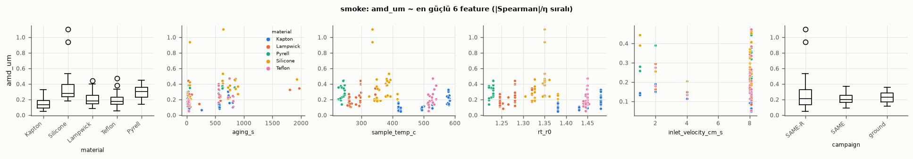

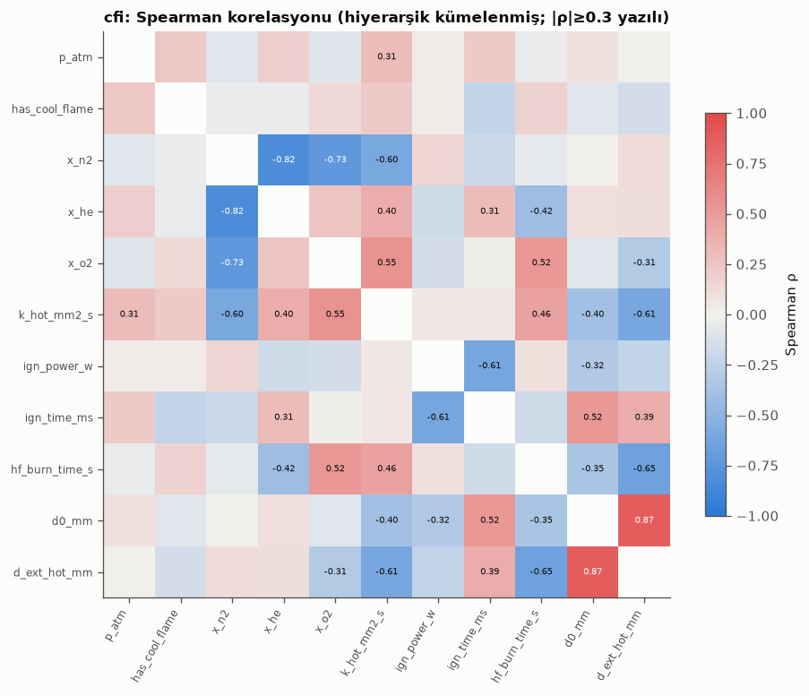

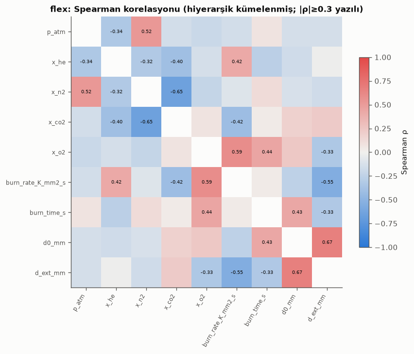

## 6. Grup etkileri ve fizik kontrolü

### 6.1 ACME (CFI-G) — tutuşma ve söndürme sınırları

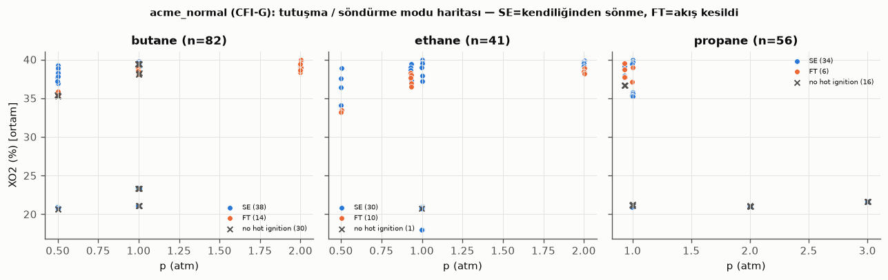

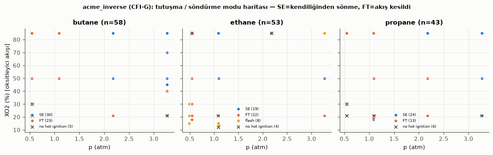

- Sıcak tutuşma oranı: normal **0.74**, inverse **0.85**.
- Normal alevlerde ~%21 O2 → bütan/propan için sıcak tutuşma yok (soğuk alev rejimi). %35–40 O2'de alevlerin çoğu kendiliğinden sönüyor (SE), 2 atm'de akış kesilmesi (FT) daha sık. Bu tablo fiziksel olarak makul: yüksek basınç ve yüksek O2 alevi radyatif sönmeye karşı güçlendiriyor ve test süre sınırına ulaşıyor.
- **O2 arttıkça yanma süresi kısalır mı?** Normal alevlerde **hayır, uzuyor** (yakıt içinde ρ=0.29–0.67). Mikrogravitede küresel alevler radyasyon kaybıyla sönüyor; O2 arttıkça alev sıcaklığı yükseliyor ve alev daha uzun süre ayakta kalıyor. Inverse etanda ilişki ters yönde (ρ=−0.40); bu testlerde ortam yakıt kesri ve gün etkisi baskın.

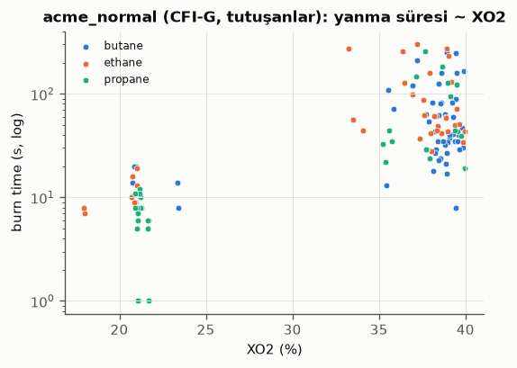

### 6.2 FLEX — d² yasası

| subset               |   n |   ols_slope |   ci_lo |   ci_hi |   theil_sen_slope |   spearman |
|:---------------------|----:|------------:|--------:|--------:|------------------:|-----------:|
| tümü                 | 260 |       1.31  |   0.936 |    1.63 |             1.7   |      0.432 |
| Completion           |  27 |       2.12  |   1.76  |    2.52 |             2.01  |      0.894 |
| Extinction           | 179 |       0.996 |   0.456 |    1.5  |             1.32  |      0.277 |
| Methanol             | 153 |       1.82  |   1.36  |    2.29 |             2     |      0.617 |
| Heptane              | 107 |       0.642 |   0.084 |    1.1  |             0.766 |      0.177 |
| Heptane & Completion |  19 |       2.03  |   1.55  |    2.56 |             1.9   |      0.81  |

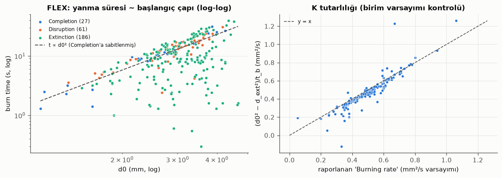

- Completion (tam yanma) alt kümesinde eğim ≈ 2: d² yasası **doğrulanıyor**. Heptan + Completion: 2.03.
- Tüm veride eğim 1.31'e düşüyor, çünkü sönmeyle biten testlerin süresi d0²'ye değil, d0² − d_ext²'ye bağlı. Heptan testlerinin çoğu sönmeyle bittiği için heptanın genel eğimi düşük (0.64). **Bu nedenle FLEX burn time hedefi test_end'den bağımsız yorumlanamaz.**
- CFI için log(hf burn time) – log(d0) eğimi **-1.42** (negatif!). Büyük damlacıklarda sıcak alev radyatif sönmeye daha erken giriyor; sıcak alev evresi d² yasasıyla değil sönme kinetiğiyle belirleniyor. (d0²−d_ext²)/t_hf ÷ khot = 0.82: birimler (s, mm²/s) tutarlı.

### 6.3 Duman — malzeme × yerçekimi × Rt/R0

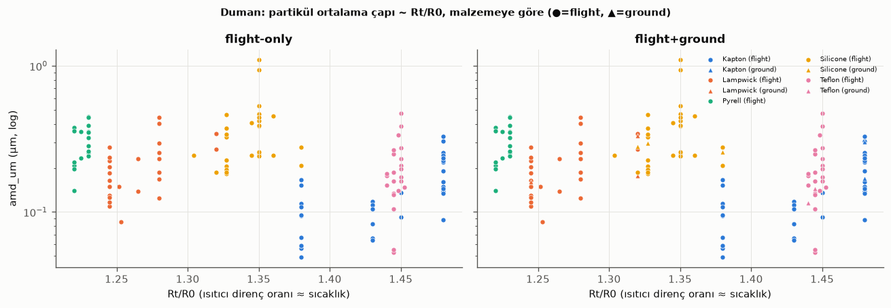

Malzeme içinde Rt/R0 ve yaşlanma etkisi (flight-only, Spearman):

| material   |   n |   rho_rt_amd |   rho_aging_amd |   rho_rt_dusttrakB |
|:-----------|----:|-------------:|----------------:|-------------------:|
| Kapton     |  33 |         0.68 |            0.15 |               0.59 |
| Lampwick   |  26 |         0.49 |          nan    |               0.24 |
| Pyrell     |  20 |         0.4  |          nan    |               0.25 |
| Silicone   |  29 |         0.43 |            0.63 |               0.13 |
| Teflon     |  23 |         0.36 |            0.37 |               0.15 |

- 5 malzemenin hepsinde ısıtıcı sıcaklığı arttıkça partikül çapı büyüyor (ρ 0.36–0.68). Bu fiziksel olarak makul: yüksek piroliz hızı daha yoğun buhar, dolayısıyla daha fazla yoğuşma ve koagülasyon demek.
- Flight vs ground: Kapton'da fark var (flight medyan 0.12 µm, ground 0.24 µm, p=0.03). Diğer malzemelerde anlamlı fark yok. **Ancak ground sütun eşlemesi doğrulanmadığı için bu karşılaştırma yalnızca betimsel.** Ayrıntı: `outputs/group_effects.md`.

### 6.4 BASS-II — O2 tüketimi ve CO/CO2

| material   | geometry       |   n |   d_o2_median |   d_co2_median |   co_final_median |   d_co_median |
|:-----------|:---------------|----:|--------------:|---------------:|------------------:|--------------:|
| Nomex      | fabric         |   3 |           0   |          0.005 |              42   |         -10.5 |
| PMMA       | film           |  21 |          -0.1 |          0.065 |              22.5 |          16   |
| PMMA       | rod            |  52 |          -0.5 |          0.42  |             159   |          87   |
| PMMA       | slab           |  20 |          -1.1 |          0.88  |             357   |         335   |
| PMMA       | sphere_section |   2 |          -0.3 |          0.275 |             126   |          79.5 |
| SIBAL      | fabric         |  25 |           0   |          0.02  |              41   |          20   |
| Wax candle | candle         |   1 |           0   |          0.1   |              56   |          34   |

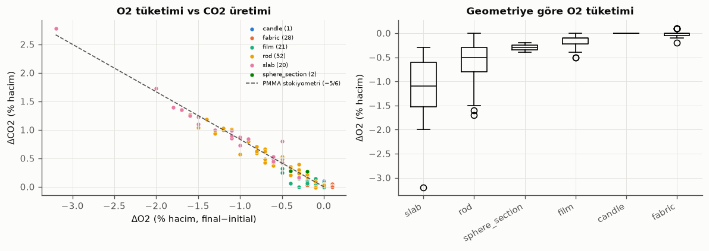

- PMMA ΔCO2/ΔO2 = -0.80 (teorik −0.83): O2 ve CO2 sensörleri birbiriyle uyumlu. ΔO2 ve ΔCO2 neredeyse aynı bilgiyi taşıyor, ikisi ayrı hedef olarak düşünülmemeli.
- O2 tüketimi geometriye göre belirgin şekilde değişiyor: kalın PMMA levhalar (slab, medyan ΔO2 −1.1 puan) ve çubuklar (−0.5) ince filmlerden (−0.1) çok daha fazla O2 tüketiyor; SIBAL ve Nomex kumaşlarda tüketim ≈0. Bu, yakıt kütlesi ve yanma süresiyle tutarlı.

## 7. Zaman serisi özeti

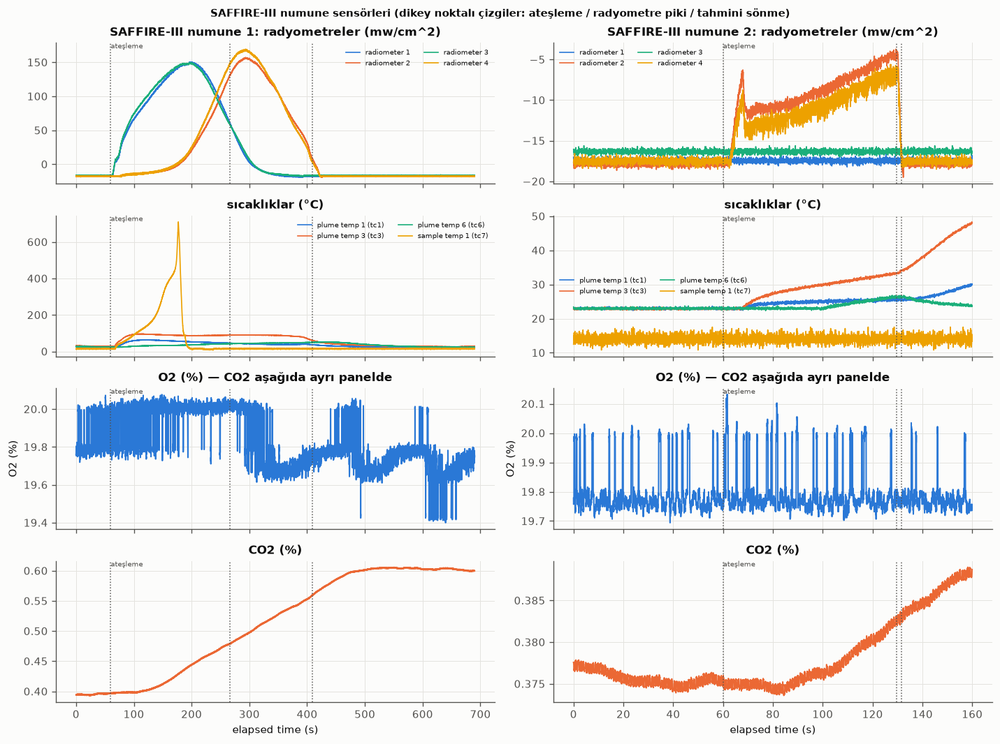

|   sample |   n_rows |   dropped_time_rows |   dt_s |   duration_s |   t_igniter_on_s |   t_igniter_off_s |   t_rad_peak_s |   rad_peak_mw_cm2 |   rad_baseline |   t_extinction_s |   flame_duration_est_s |   time_above_half_peak_s |   rad_auc |   plume_T_peak_C |   o2_drop_pct |   co2_rise_pct |
|---------:|---------:|--------------------:|-------:|-------------:|-----------------:|------------------:|---------------:|------------------:|---------------:|-----------------:|-----------------------:|-------------------------:|----------:|-----------------:|--------------:|---------------:|
|        1 | 2.09e+04 |                   0 |   0.03 |          690 |               60 |                68 |            266 |              99.8 |          -17.3 |              409 |                  349   |                    232   |   2.6e+04 |             95.6 |          0.39 |           0.21 |
|        2 | 4.85e+03 |                   0 |   0.03 |          160 |               60 |                68 |            130 |             -11   |          -17.3 |              132 |                   71.5 |                     48.9 | 279       |             48.4 |          0.08 |           0.01 |

- **Numune 1 (concurrent):** ateşleme 60 s; radyometre 1/3 ile 2/4 sırayla pik yapıyor (alev cephesinin geçişi). Tahmini alev süresi **349 s**, radyatif pik ≈ 100 mW/cm², O2 düşüşü 0.39 puan, CO2 artışı 0.21 puan.
- **Numune 2 (opposed):** yalnızca radyometre 2/4 zayıf bir sinyal veriyor. ~132 s'deki keskin düşüş doğal bir sönmeden çok kaydın kesilmesine ya da testin sonlandırılmasına benziyor; tahmini süre (~72 s) alt sınır olarak alınmalı.
- SAFFIRE-III 1 Hz Cygnus export'unun satırlarının %93'ü tekrar veya sentinel; `relative time (ms)` milisaniye cinsinden. Üç export birleştirilmedi.

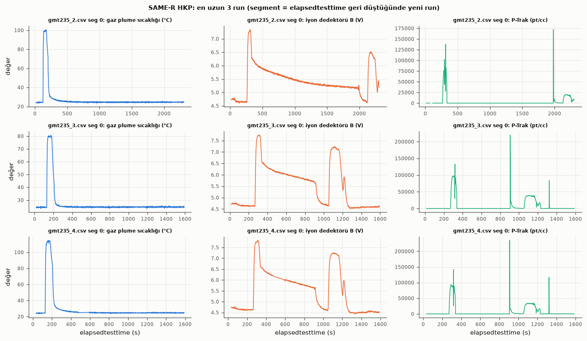

- SAME-R HKP: 44 ham dosya, `elapsedtesttime` geri düşüşleriyle **72 segment** bulundu; >60 s olan 49 segmentin süre medyanı 1297 s. 1974 P-Trak hücresi sentinel ya da negatif değer içeriyordu (NaN yapıldı).

**Run başına üretilebilecek feature'lar:** pik değer, pike kadar geçen süre, eşik üstü süre, yükselme ve sönüm eğimi, taban çıkarılmış AUC (radyatif enerji vekili), O2 düşüşü / CO2 artışı, taban seviyesi ve gürültü (MAD), run süresi, P-Trak/DustTrak pik ve ortalaması. Liste: `outputs/timeseries_summary.md`.

## 8. Model önerileri (eğitim yapılmadı)

Kural tabanlı öneriler veri özelliklerinden türetildi; tam metin `outputs/model_recommendations.md` dosyasında. Özet:

| Hedef | Baseline | Ağaç modeli | Doğrulama grubu | Kritik not |
|---|---|---|---|---|
| flex.burn_time_s | Ridge (sqrt hedef) | LightGBM/XGBoost + monotone(d0 +), CatBoost | year / fuel×diluent | test_end ile birlikte değerlendir (erken kesilme) |
| flex.burn_rate_K | Ridge | GBM + monotone(x_o2 +) | fuel×diluent | mol kesirleri kompozisyonel → x_n2'yi çıkar |
| cfi.k_hot_mm2_s | Ridge (sqrt) | RF / sığ GBM, CatBoost (fuel, diluent, fiber) | fuel×diluent | He etkisi seyreltici grubundan geliyor |
| smoke.amd_um | Ridge (log) + material one-hot | CatBoost (material, campaign) | material (LOGO) | M0/M1 sızıntı; flight-only başla |
| acme_normal.hot_ignition | Lojistik (balanced) | RF / CatBoost, monotone(xo2 +) | day × fuel | PSI-10'da etiket yok |
| acme_*.burn_time_s | Ridge (log) | sığ GBM | day | FT testlerinde süre sansürlü → AFT/survival düşün |
| bass2.d_o2_pct | Ridge | CatBoost | pi | PI ile malzeme iç içe; etkiler ayrıştırılamayabilir |

**Genel:** n=108–274 küçük olduğu için derinlik 2–4, güçlü L2 ve erken durdurma kullanılmalı. Metrikler (MAE/RMSE, ROC-AUC/PR-AUC, macro-F1) grup bazlı CV'de raporlanmalı. Rastgele KFold sonuçları gruplar arasındaki sızıntı yüzünden iyimser çıkar.

## 9. Riskler, açık sorular ve sonraki adımlar

- **Eksik dosya:** `smoke_dataset.csv` bulunamadı. Ekip asıl dosyayı paylaşırsa `01_load_core.py::smoke()` ona yönlendirilmeli; o durumda da ground eşlemesi belgeyle doğrulanmalı.
- **Birim belirsizlikleri:** FLEX K (mm²/s) fiziksel kontrolle desteklendi. CFI 'hf burn time' (s) ve radyasyon sütunları (`unit_unknown`) için belge kontrolü gerekiyor.
- **Anlamı belirsiz sütunlar:** ACME `TFP` (Yes/No) hiç kullanılmadı; anlamı öğrenilirse sızıntı mı feature mı karar verilmeli.
- **Sansür:** ACME FT ve FLEX Extinction/Disruption testlerinde yanma süresi tam süre değil.
- **Karıştırıcılar:** gün (ACME-inverse), PI (BASS-II) ve malzeme (smoke) kontrol edilmeden kurulan modeller yanıltıcı olur.
- **Sonraki adımlar:** (1) SAFFIRE/HKP run-feature'larını tablolaştırmak; (2) PSI-10 için ham veriden (`*_data.csv`) yanma süresi türetmenin fizibilitesi; (3) model aşamasında `feature_catalog.csv` içindeki `role in {feature}` sütunları ve önerilen GroupKFold şemasıyla başlamak.

## Ek: dosyalar

- Scriptler: `analysis/scripts/00_inventory.py … 09_build_report.py` (idempotent; iki ardışık çalıştırmada 50 çıktı dosyası birebir aynı)
- Ara tablolar: `analysis/data/*.parquet` (her satırda `psi_id`, `source_file`, `source_row`)
- Özetler: `analysis/outputs/` · Figürler: `analysis/figures/` · Loglar: `analysis/logs/`

